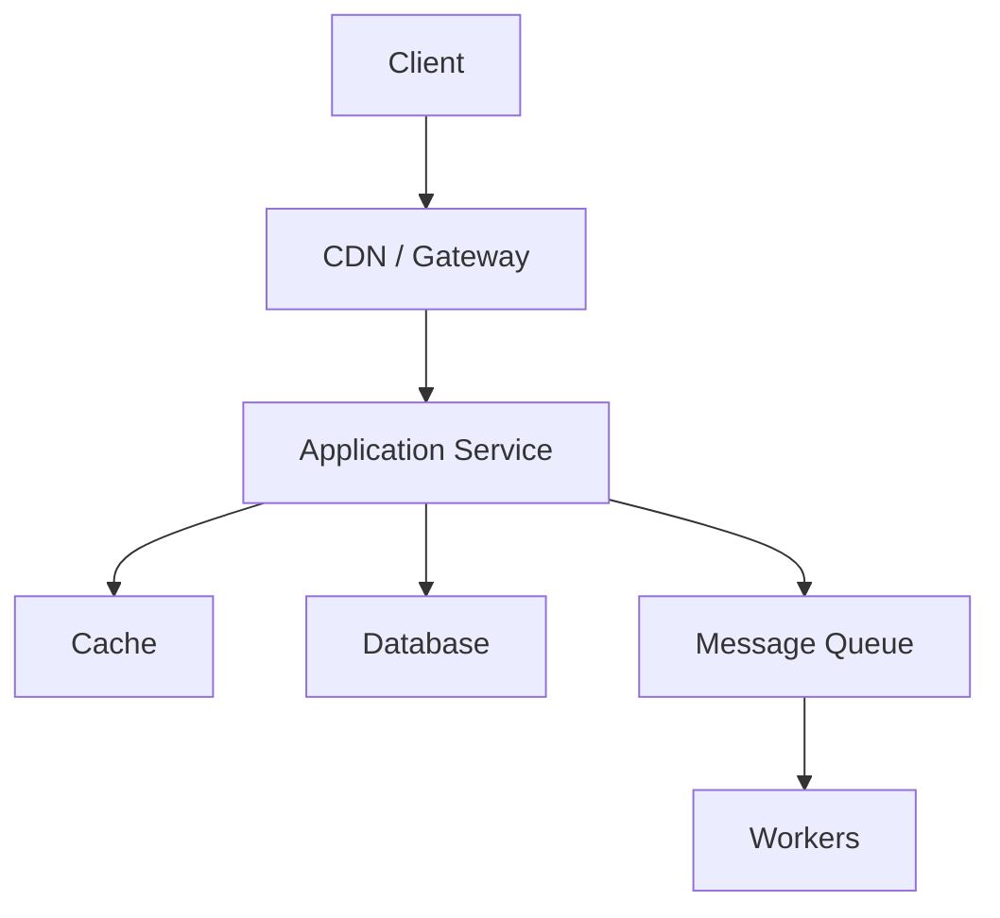

# 系统设计

> 系统设计不是堆组件，而是在约束下做取舍。

系统设计最容易犯的错误，是一上来就画微服务、缓存、消息队列和分库分表，却说不清用户要完成什么、峰值 QPS 多少、数据能丢多久、故障时允许降级到什么程度。组件不是答案，约束才是。

一个好的设计，先明确问题，再给最小可行方案，最后说明瓶颈、失败路径和取舍。它不追求“看起来复杂”，而追求“在给定约束下能工作、能扩展、能回滚”。

## 本章目标

学完本章，你应该能够：

- 用统一框架回答系统设计问题。
- 根据功能和非功能需求做容量估算。
- 选择缓存、队列、锁、数据库等基础组件。
- 说明方案瓶颈、失败路径和取舍。

## 系统设计在回答什么

系统设计先要回答功能需求和非功能需求。功能需求是核心用户路径、必须支持的能力和可以后置的能力；非功能需求是可用性、延迟、吞吐、一致性、持久性、成本、合规和团队约束。

| 指标 | 要回答的问题 |
| --- | --- |
| 可用性 | 允许多长时间不可用？99.9% 还是 99.99%？ |
| 延迟 | P50、P95、P99 目标是多少？ |
| 吞吐 | 峰值 QPS、写入量、消息量是多少？ |
| 一致性 | 可以接受最终一致吗？ |
| 持久性 | 数据丢失的容忍度是多少？ |
| 成本 | 预算和资源限制是什么？ |

接下来做容量估算。估算不需要精确，但要能判断单机是否够、是否需要缓存、是否需要分库分表、是否需要消息队列削峰。

```text
日请求数 = DAU × 人均请求数
平均 QPS = 日请求数 / 86400
峰值 QPS = 平均 QPS × 峰值系数（通常 2–10）
存储 = 日增数据 × 保留天数 × 副本数
带宽 = 峰值 QPS × 平均响应大小
```

## 容量估算与组件地图

估算之后，再定义 API 和数据模型：核心接口、请求/响应结构、分页、幂等、版本、错误码和限流策略。然后画最小可行架构：请求如何进入系统，数据写到哪里，缓存如何更新，失败如何重试，如何保证幂等。



| 组件 | 解决的问题 | 章节 |
| --- | --- | --- |
| 缓存 | 降低读延迟和数据库压力 | [缓存](/system-design/cache) |
| 消息队列 | 解耦、异步、削峰 | [消息队列](/system-design/message-queue) |
| 一致性 | 多副本、多服务之间的数据一致 | [一致性](/system-design/consistency) |
| 限流 | 保护系统不被流量打垮 | [限流](/system-design/rate-limiting) |
| 分布式锁 | 跨进程互斥 | [分布式锁](/system-design/distributed-lock) |
| 数据库设计 | 建模、索引、事务、分片 | [数据库设计](/system-design/database-design) |
| 权限系统 | 谁能做什么 | [权限系统](/system-design/auth-system) |
| 登录系统 | 身份认证与会话 | [登录系统](/system-design/login-system) |

## 常见取舍

| 取舍 | 偏左 | 偏右 |
| --- | --- | --- |
| 一致性 vs 可用性 | 强一致，故障时可能拒绝请求 | 最终一致，故障时继续服务 |
| 延迟 vs 成本 | 多级缓存、就近部署 | 减少副本、集中部署 |
| 简单 vs 灵活 | 单体、单库 | 微服务、多存储 |
| 同步 vs 异步 | 立即得到结果 | 解耦、削峰、最终一致 |
| SQL vs NoSQL | 事务、关系查询 | 灵活 schema、水平扩展 |

每个方案都要说明收益、成本、风险和适用边界。没有取舍的方案，通常只是还没想到代价。

## 面试与评审怎么答

系统设计面试或方案评审，可以按这个顺序展开：

1. 澄清功能和目标，不要一上来画架构。
2. 估算 QPS、存储、带宽和增长。
3. 定义 API 和数据模型。
4. 画最小可行架构。
5. 深入一两个核心流程。
6. 指出瓶颈和扩展方案。
7. 说明失败处理、降级和取舍。

好的回答不是“用了多少组件”，而是“为什么在这个约束下选择这些组件”。如果面试官追问“规模扩大 10 倍”，你应该能指出最先坏的环节；如果追问“要求强一致”，你应该能说清哪些路径要改。

::: tip 先澄清需求，再画架构
系统设计题没有标准答案，只有约束下的取舍。先问用户规模、读写比例、一致性、延迟和成本，再决定要不要缓存、队列、分片或微服务。
:::

## 总结

系统设计可以压缩成三句话：

- 先明确功能和约束，再做估算和组件选型。
- 先画最小可行架构，再深入核心流程和瓶颈。
- 每个方案都要说明取舍、失败路径和回滚。

如果只能记住一件事：系统设计不是证明你知道多少组件，而是证明你能在约束下做出一致的选择。

## 相关阅读

- [缓存](/system-design/cache)
- [消息队列](/system-design/message-queue)
- [一致性](/system-design/consistency)
- [限流](/system-design/rate-limiting)
- [数据库设计](/system-design/database-design)
