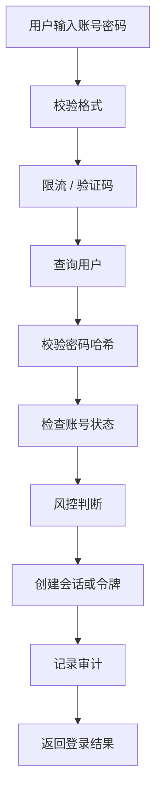

# 登录系统

> 登录系统的目标不是“让用户进来”，而是“在正确的人、正确的时间、正确的设备上，安全地建立会话”。

登录页看起来只是一个表单，背后却要处理密码存储、账号枚举、暴力破解、会话撤销、多设备、找回密码、风控和审计。任何一个环节做错，都可能让攻击者用很低的成本拿到账号。

登录系统最危险的地方，是它同时面向公网、持有身份凭证，并且经常被低估为“CRUD”。它不是一个普通业务模块，而是整个系统的安全入口。

## 本章目标

学完本章，你应该能够：

- 设计完整的登录、失败和风控流程。
- 使用慢哈希安全存储密码。
- 选择服务端会话或 JWT，并支持撤销。
- 处理 MFA、SSO、密码重置和审计。

## 登录流程到底在防什么

一次登录要经过：校验格式、限流/验证码、查询用户、校验密码哈希、检查账号状态、风控判断、创建会话或令牌、记录审计、返回结果。

每一步都要考虑失败：账号不存在、密码错误、账号锁定、验证码过期、设备异常、网络超时。不要只写 happy path。

账号枚举是常见漏洞：攻击者可以通过不同响应判断账号是否存在。防护方式是统一错误提示“账号或密码错误”、统一响应时间、对登录/注册/找回密码都做限流，必要时使用验证码或风险挑战。

## 密码存储

密码必须使用慢哈希：bcrypt、scrypt 或 Argon2；每个密码使用独立 salt；使用足够的工作因子；需要时增加 pepper 并安全保存；支持算法升级，登录时渐进式重哈希。

明文存储、MD5/SHA-1/SHA-256 直接哈希、全局固定 salt、自己发明加密算法、把密码写进日志，都是错误做法。密码哈希不是加密：加密可逆，哈希不可逆；密码存储必须用慢哈希。

::: details 小问题：为什么不能用 SHA-256 存密码？
SHA-256 太快，适合校验完整性，不适合抵抗暴力破解。攻击者可以用 GPU 每秒尝试大量候选密码。bcrypt/scrypt/Argon2 通过工作因子和内存成本让每次尝试都变慢，才能提高离线破解成本。
:::

## 会话、JWT 与撤销

服务端会话把状态存在服务端，容易撤销，但需要共享存储或粘滞会话。JWT 自包含、服务端无状态校验，适合跨服务、跨域，但撤销困难，通常依赖短期过期 + 刷新令牌。

| 方式 | 优点 | 代价 |
| --- | --- | --- |
| 服务端会话 | 容易撤销、状态可控 | 需要共享存储或粘滞 |
| JWT | 无状态、跨服务方便 | 撤销困难、依赖短期过期 |

实践建议是短期 Access Token + 长期 Refresh Token，Refresh Token 轮换，旧令牌失效；支持登出和全部设备下线；不要把敏感信息放进 JWT；校验签名、过期时间、issuer 和 audience。Cookie 要设置 `HttpOnly`、`Secure`、`SameSite`，并设置合理过期时间。

::: warning JWT 不是会话
JWT 只是令牌格式，不是“登录状态”的完整方案。它无法天然支持即时撤销、设备管理和权限变更。需要这些能力时，仍然要有服务端状态、黑名单或短期令牌 + 刷新机制。
:::

## MFA、SSO 与账号恢复

MFA 的方式各有取舍：TOTP 安全性较高、体验较好；WebAuthn/Passkey 安全性高、需要设备支持；短信验证码体验好，但有 SIM 交换和拦截风险；邮件验证码依赖邮箱安全。高风险操作可以要求二次验证，而不是只依赖登录时的 MFA。

OAuth2 是授权框架，不是登录协议；OIDC 在 OAuth2 上增加身份层；SSO 让用户一次登录访问多个应用。接入时要校验 `state` 防 CSRF，校验 `redirect_uri` 白名单，校验 ID Token 的签名、issuer、audience 和 nonce，不要把 access token 当身份信息。

密码重置链接要一次性、短有效期、不可预测；重置后使旧会话失效；不泄露账号是否存在；记录审计；支持管理员强制重置。账号找回是高危入口，不能比登录本身更弱。

::: info 密码重置是高风险入口
攻击者不一定攻击登录页，也可能攻击找回密码、邮箱验证、客服重置。所有能改变凭证的路径，都要有同样的限流、验证和审计。
:::

## 风控与审计

风险信号包括新设备、新地区/不可能旅行、异常时间、高频失败、代理/VPN/Tor、账号行为突变。处理方式包括增加验证码、要求 MFA、限制敏感操作、通知用户和人工审核。

账号状态要明确：ACTIVE、LOCKED、DISABLED、PENDING_VERIFICATION、DELETED。登录、重置密码和敏感操作都要检查状态。

审计要记录登录成功/失败、IP、设备、User-Agent、失败原因、MFA 结果、会话创建/撤销、密码修改/重置和权限变更。不要记录密码、验证码、完整 Token。

## Login System Review 矩阵

| 维度 | 必须回答 | 不满足时怎么办 |
| --- | --- | --- |
| 密码 | 是否使用慢哈希和独立 salt？ | 迁移到 bcrypt/Argon2 |
| 枚举 | 是否会泄露账号是否存在？ | 统一提示和响应时间 |
| 限流 | 登录、注册、重置是否限流？ | 加 IP/账号/设备维度 |
| 会话 | 是否支持撤销和设备下线？ | 加服务端状态或黑名单 |
| JWT | 是否校验签名、过期和 audience？ | 收紧校验和有效期 |
| MFA | 高风险场景是否二次验证？ | 加 TOTP/WebAuthn |
| 恢复 | 重置链接是否一次性、短有效期？ | 加重置 token 和审计 |
| 审计 | 是否记录安全事件？ | 接入日志和告警 |

## 总结

登录系统的核心，是安全地建立和撤销身份：

- 密码用慢哈希，登录防枚举和暴力破解。
- 会话/JWT 要支持撤销、轮换和设备管理。
- MFA、SSO、密码重置和风控，都是登录安全的一部分。

如果只能记住一件事：登录不是“验证一次密码”，而是“在正确的人、设备和时间上建立可撤销的会话”。

## 相关阅读

- [权限系统](/system-design/auth-system)
- [如果让我设计微信](/system-design/if-i-were-wechat)
- [如果让我设计 GitHub](/system-design/if-i-were-github)
- [Code Review](/software-engineering/code-review)
