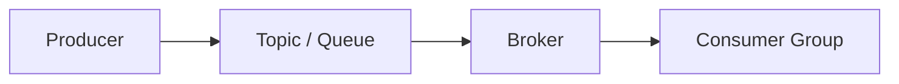
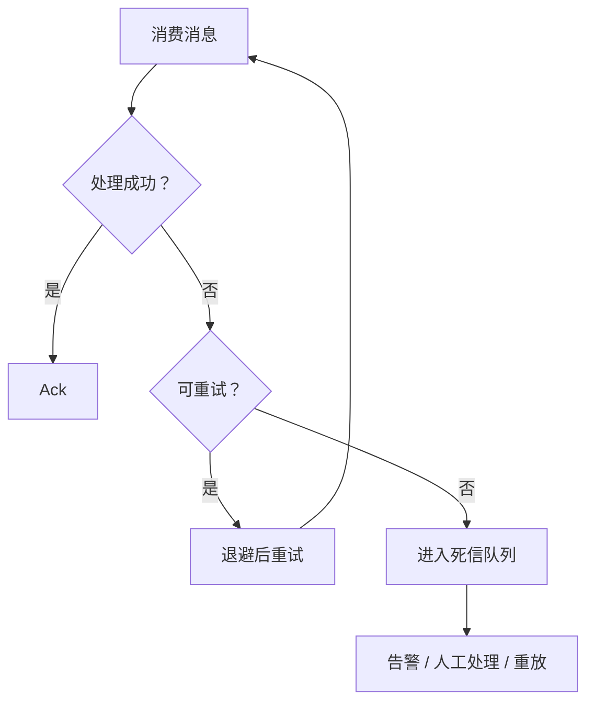
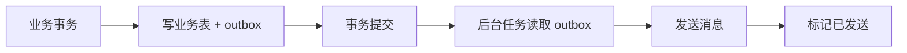

# 消息队列

> 消息队列解决的是“解耦和异步”，但会把一致性问题从一次调用转移到一条消息。

下单之后要发短信、加积分、通知仓库、更新搜索索引。如果这些动作都塞进下单接口，主流程会被非关键步骤拖慢，一个下游抖动就可能让下单失败。消息队列把这些动作拆出去，让主流程先完成，下游按自己的能力消费。

但消息不是免费的。生产者可能发送失败，Broker 可能丢消息，消费者可能重复消费，重试可能打乱顺序，积压可能让端到端延迟失控。消息队列把同步调用的一致性问题，变成了异步消息的一致性问题。

## 本章目标

学完本章，你应该能够：

- 判断一个场景是否真的需要消息队列。
- 理解至少一次投递、幂等和顺序。
- 设计重试、死信和消费者背压。
- 用 outbox 解决数据库与消息不一致。

## 消息队列到底解决什么

消息队列主要解决四类问题：解耦、异步、削峰和缓冲。生产者不需要知道消费者是谁；主流程不等待非关键步骤；瞬时流量可以先进入队列；消费者按自己的能力处理，而不是被峰值打垮。事件驱动架构也常以消息队列为基础，让一个事件触发多个下游。

但消息队列不是默认答案。同步调用更简单、更容易追踪结果；如果业务需要立即知道下游结果，或者消息量很小、失败重试很少，直接调用可能更合适。引入 MQ 之前，先问：这次解耦是否值得多一套运维和一致性成本？

## 投递语义与幂等

消息投递有三种常见语义：最多一次可能丢，至少一次可能重复，恰好一次端到端很难。工程上更现实的目标是“至少一次投递 + 消费幂等”。

| 语义 | 含义 | 现实 |
| --- | --- | --- |
| At-most-once | 最多一次，可能丢 | 不重试，先 ack 后处理 |
| At-least-once | 至少一次，可能重复 | 先处理成功后 ack，失败重试 |
| Exactly-once | 恰好一次 | 端到端很难，通常靠幂等实现 |

幂等要覆盖重复发送、消费成功后 ack 失败、消费者重启、重试和补偿。常见方案是消息唯一 ID + 去重表、业务唯一键 + 唯一索引、状态机只允许合法转换、版本号/CAS，或者记录幂等 key 的处理结果。

::: warning 不要假设消息只来一次
至少一次投递意味着重复是常态，不是异常。支付回调、扣库存、发券、发通知这些操作，如果没有幂等，一次重试就可能造成重复副作用。
:::

## 顺序、重试与死信

全局顺序成本很高，通常只保证分区内顺序：用业务 key 选择分区，例如 `orderId`，让同一个订单的消息进入同一分区，消费者按分区顺序处理。多分区无法保证全局顺序；重试可能打乱顺序；消费者并发处理也会破坏顺序。顺序和吞吐需要取舍。

重试要区分可恢复错误和终止错误。网络超时、临时不可用可以退避重试；参数非法、业务拒绝不应该无限重试。超过次数进入死信队列，死信要有告警、查看、重放和人工处理流程。不要无限重试，否则一个坏消息会变成持续故障。

## Outbox 与消费端设计

业务数据和消息发送在同一个数据库事务中完成，是 outbox 模式的核心：在业务事务里写 order 表和 outbox 表，事务提交后由后台任务读取 outbox 发送消息，发送成功后标记已发送。它避免“数据库提交了，消息没发出去”，也避免“消息发出去了，数据库回滚了”。

消费端要控制并发、处理超时和重试、监控消费延迟、优雅停机、隔离失败并可回放。消息设计要包含消息 ID、类型、版本、时间、traceId、业务主键，负载尽量小，大对象放对象存储，避免敏感信息。schema 演进要兼容旧消费者。

## 积压、选型与可观测性

消费者处理不过来时，可以增加消费者（受分区数限制）、优化单条处理耗时、批量处理、降级非关键逻辑、限流生产者或扩容下游。监控要覆盖 consumer lag、消费速率、重试次数、死信数量和端到端延迟。

| 中间件 | 特点 | 适用 |
| --- | --- | --- |
| Kafka | 高吞吐、分区顺序、日志型 | 事件流、日志、数据管道 |
| RabbitMQ | 路由灵活、低延迟 | 业务消息、任务队列 |
| RocketMQ | 事务消息、顺序消息 | 电商、金融业务 |
| Pulsar | 多租户、存算分离 | 大规模消息平台 |
| SQS | 托管、简单 | AWS 生态、解耦任务 |

::: details 小问题：消息队列能保证 exactly-once 吗？
端到端很难。Broker 可能支持事务或幂等生产者，但业务副作用仍然可能因为消费失败、ack 丢失或跨系统调用而重复。工程上更可靠的做法是“至少一次投递 + 消费幂等 + 对账”。
:::

## Message Queue Review 矩阵

| 维度 | 必须回答 | 不满足时怎么办 |
| --- | --- | --- |
| 必要性 | 为什么需要 MQ？同步调用是否更简单？ | 能用同步解决就先同步 |
| 语义 | 投递语义是什么？ | 明确 at-least-once + 幂等 |
| 幂等 | 消费端是否幂等？ | 加去重表、唯一约束或状态机 |
| 顺序 | 是否需要顺序？如何分区？ | 用业务 key 选分区 |
| 可靠 | 生产、Broker、消费三侧是否可靠？ | 确认、复制、ack 和重试 |
| 一致 | 是否使用 outbox 或本地消息表？ | 补事务消息或 outbox |
| 失败 | 重试和死信策略是什么？ | 加退避、死信和告警 |
| 观测 | 是否监控积压和端到端延迟？ | 接入 lag、重试和死信指标 |

## 总结

消息队列的价值是解耦和异步，代价是一致性和运维复杂度：

- 至少一次投递 + 消费幂等，比追求 exactly-once 更现实。
- 顺序通常只保证分区内，重试和并发都会破坏全局顺序。
- outbox、死信、积压监控，是消息系统能稳定运行的基本配套。

如果只能记住一件事：消息队列没有消除一致性问题，只是把它从“一次调用”转移到了“一条消息”。

## 相关阅读

- [一致性](/system-design/consistency)
- [缓存](/system-design/cache)
- [限流](/system-design/rate-limiting)
- [如果让我设计微信](/system-design/if-i-were-wechat)
