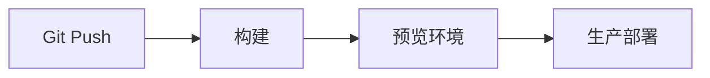

# Cloudflare

> Cloudflare 的价值是把 DNS、CDN、安全和边缘计算放在离用户更近的一层。

## 本章目标

学完本章，你应该能够：

- 配置 DNS、CDN 和 TLS。
- 使用 WAF、速率限制和缓存规则。
- 判断何时使用 Workers、Pages、R2 或 Tunnel。
- 识别缓存、安全和回源配置错误。

## 请求路径

## DNS

- 托管域名。
- 配置 A / AAAA / CNAME。
- 代理开关（橙色云）决定是否经过 Cloudflare。
- 使用 DNSSEC。
- 不要把所有记录都代理，按需选择。

## CDN 与缓存

- 静态资源长缓存。
- HTML 短缓存或不缓存。
- 按路径、文件类型配置缓存规则。
- 使用 cache key 控制维度。
- 发布后 purge 缓存。

## WAF

- 托管规则。
- 自定义规则。
- 速率限制。
- Bot 管理。
- 地理/ASN 限制。

原则：

- 先观察，再拦截。
- 避免误伤正常用户。
- 重要规则有日志和回滚。

## TLS

- 开启 HTTPS。
- 选择合适 TLS 模式。
- 源站证书有效。
- 开启 HSTS 前确认所有子域支持 HTTPS。
- 自动证书续期。

## Workers

适合：

- 边缘路由。
- A/B 测试。
- 鉴权。
- 简单 API。
- 请求/响应改写。

注意：

- 运行时间限制。
- 内存限制。
- 不要做长任务。
- 注意冷启动和成本。

## Pages

适合：

- 静态站点。
- 前端应用。
- 预览部署。

流程：

## R2

适合：

- 对象存储。
- 静态资源。
- 备份。
- 大文件。

注意：

- 权限最小化。
- 生命周期策略。
- 访问日志。

## Tunnel

适合：

- 不暴露公网端口。
- 内网服务安全接入。
- 本地开发预览。

原则：

- 只暴露必要服务。
- 使用访问控制。
- 监控连接状态。

## Zero Trust

- 身份验证。
- 设备信任。
- 最小权限。
- 应用访问策略。
- 审计。

## 常见错误

- DNS 代理配置错误。
- 缓存登录/个性化接口。
- WAF 规则误伤。
- TLS 模式错误。
- HSTS 开太早。
- Workers 做长任务。
- R2 权限过大。
- Tunnel 暴露过多服务。
- 不监控 5xx 和缓存命中率。

## Cloudflare Review 清单

- [ ] DNS 记录和代理开关是否正确？
- [ ] 是否开启 HTTPS 和有效证书？
- [ ] 缓存规则是否区分静态/动态？
- [ ] WAF 是否有日志和回滚？
- [ ] 是否配置速率限制？
- [ ] Workers 是否适合当前任务？
- [ ] Pages 是否有预览环境？
- [ ] R2 权限是否最小？
- [ ] Tunnel 是否只暴露必要服务？
- [ ] 是否监控 5xx、缓存命中率和延迟？

## 相关阅读

## 总结

Cloudflare 的核心，是把 DNS、CDN、安全和边缘计算放到离用户最近的一层：

- DNS 代理开关、TLS 模式和源站证书要先确认。
- 缓存区分静态/动态，WAF 规则要可回滚。
- Workers/Pages/R2/Tunnel 各有边界，不暴露多余服务。

如果只能记住一件事：边缘层能挡掉大部分流量问题，也可能把请求挡错，所以规则要可观测、可回滚。

- [Nginx](/tools/nginx)
- [Linux](/tools/linux)
- [可观测性](/software-engineering/observability)
