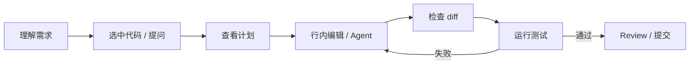

# Cursor

> 这篇从“工具配置”角度讲 Cursor；补全、Agent 和代码审查的工程方法见 [Cursor AI 编程](/tools/cursor-ai-coding)。

## 本章目标

学完本章，你应该能够：

- 配置模型、规则和代码库索引。
- 区分 Tab、行内编辑、Chat 和 Agent。
- 限制敏感文件并检查 diff。
- 建立团队统一的 AI 编程规范。

## 安装与基础配置

- 导入 VSCode 设置、快捷键和扩展。
- 登录账号。
- 选择模型。
- 配置隐私和索引范围。
- 配置项目规则。

## 项目规则

规则应写清楚：

- 技术栈。
- 构建/测试命令。
- 代码风格。
- 目录结构。
- 禁止修改的路径。
- 危险操作。

规则要短、具体、可执行。

## 代码库索引

- 只索引需要的目录。
- 排除生成代码、vendor、构建产物。
- 排除敏感文件。
- 大仓库限制范围。
- 文件变更后增量更新。

## 常用工作流

## 补全

- 适合重复模式。
- 不要盲按 Tab。
- 检查 API 和导入。
- 关键逻辑补测试。

## 行内编辑

- 选中范围要准确。
- 指令要具体。
- 看 diff 再接受。
- 不修改无关代码。

## Chat

- 解释代码。
- 找调用链。
- 生成测试。
- 比较方案。

要求引用文件，不要编造 API。

## Agent

- 先计划。
- 小步修改。
- 看 diff。
- 运行测试。
- 可回滚。

## 隐私

- 明确代码是否上传和保留。
- 不上传密钥、`.env`、客户数据。
- 配置忽略规则。
- 企业环境关注数据驻留。
- 审查扩展权限。

## 团队规范

- 共享规则文件。
- 统一模型和隐私策略。
- 统一测试命令。
- 统一 review 流程。
- 记录 AI 生成代码的来源。

## 常见错误

- 不配置忽略规则。
- 索引敏感文件。
- 盲接受补全。
- 不读 diff。
- 一次改太多。
- 不运行测试。
- 不共享项目规则。
- 不审查扩展。

## Cursor Review 清单

- [ ] 是否配置项目规则？
- [ ] 是否限制索引范围？
- [ ] 是否排除敏感文件？
- [ ] 是否检查补全 API？
- [ ] 是否查看 diff？
- [ ] 是否运行测试？
- [ ] 是否可回滚？
- [ ] 团队是否统一规范？

## 相关阅读

## 总结

Cursor 的核心，是把 AI 补全、编辑和 Agent 放进 IDE，并用规则约束上下文：

- 项目规则、索引范围和隐私策略先配置。
- 补全检查 API，行内编辑看 diff，Agent 要测试和回滚。
- 团队统一规范，避免每个人用出不同结果。

如果只能记住一件事：AI 生成越多，验证和回滚越重要。

- [Cursor AI 编程](/tools/cursor-ai-coding)
- [VSCode](/tools/vscode)
- [Context](/ai-coding/context)
