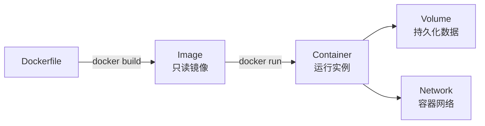
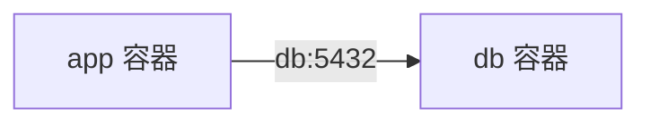

# Docker

> Docker 的价值是“把运行环境和应用一起打包”，让构建、测试和部署更可重复。

## 本章目标

学完本章，你应该能够：

- 区分镜像、容器、卷和网络。
- 写出可缓存、非 root 的 Dockerfile。
- 用 Compose 组织本地环境。
- 识别镜像、密钥和权限风险。

## 核心概念



| 概念 | 含义 |
| --- | --- |
| Image | 只读模板 |
| Container | 镜像的运行实例 |
| Dockerfile | 构建镜像的脚本 |
| Volume | 持久化数据 |
| Network | 容器间通信 |
| Registry | 镜像仓库 |

## 常用命令

```bash
docker build -t order-service:1.0 .
docker run -d --name order -p 8080:8080 order-service:1.0
docker ps
docker logs -f order
docker exec -it order sh
docker stop order
docker rm order
docker images
docker rmi order-service:1.0
```

## Dockerfile

```dockerfile
FROM eclipse-temurin:21-jre

WORKDIR /app
COPY build/libs/order-service.jar app.jar

RUN useradd -r -u 1001 app
USER app

EXPOSE 8080
ENTRYPOINT ["java", "-jar", "/app/app.jar"]
```

原则：

- 用多阶段构建。
- 基础镜像固定版本。
- 不把密钥打进镜像。
- 用非 root 用户。
- 只复制必要文件。
- 利用缓存顺序。

## 多阶段构建

```dockerfile
FROM gradle:8-jdk21 AS build
WORKDIR /src
COPY . .
RUN gradle bootJar

FROM eclipse-temurin:21-jre
WORKDIR /app
COPY --from=build /src/build/libs/*.jar app.jar
ENTRYPOINT ["java", "-jar", "/app/app.jar"]
```

## 分层缓存

- 变化少的层放前面。
- 依赖安装和源码复制分开。
- 不要把整个仓库复制后再安装依赖。

## 卷

```bash
docker volume create app-data
docker run -v app-data:/app/data order-service:1.0
```

原则：

- 数据不要只存在容器层。
- 数据库用 volume。
- 备份 volume。

## 网络

```bash
docker network create app-net
docker run --network app-net --name db postgres:16
docker run --network app-net --name app order-service:1.0
```

容器内用服务名访问：



## Docker Compose

```yaml
services:
  app:
    build: .
    ports:
      - "8080:8080"
    environment:
      DB_URL: jdbc:postgresql://db:5432/app
    depends_on:
      - db

  db:
    image: postgres:16
    environment:
      POSTGRES_PASSWORD: example
    volumes:
      - db-data:/var/lib/postgresql/data

volumes:
  db-data:
```

## 安全

- 非 root 运行。
- 最小基础镜像。
- 固定镜像版本，避免 `latest`。
- 扫描漏洞。
- 不把密钥写进镜像。
- 限制容器权限。
- 只暴露必要端口。

## 常见错误

- 镜像巨大。
- 用 `latest`。
- 以 root 运行。
- 密钥打进镜像。
- 数据只存容器层。
- 不限制资源。
- 不扫描漏洞。
- 构建缓存顺序错误。
- Compose 依赖启动顺序当健康检查。

## Docker Review 清单

- [ ] 是否多阶段构建？
- [ ] 基础镜像是否固定版本？
- [ ] 是否非 root 运行？
- [ ] 是否只复制必要文件？
- [ ] 密钥是否外置？
- [ ] 数据是否用 volume？
- [ ] 是否限制 CPU/内存？
- [ ] 是否扫描镜像漏洞？
- [ ] 是否有健康检查？
- [ ] 是否只暴露必要端口？

## 相关阅读

## 总结

Docker 的核心，是把应用和运行环境打包成可重复的镜像：

- 多阶段构建、固定版本、非 root、只复制必要文件。
- 数据放 volume，密钥外置，容器资源有上限。
- 镜像要扫描漏洞，容器要有健康检查。

如果只能记住一件事：镜像不可变、配置外置，才能“一次构建、多处部署”。

- [Linux](/tools/linux)
- [Nginx](/tools/nginx)
- [CI/CD](/software-engineering/ci-cd)
