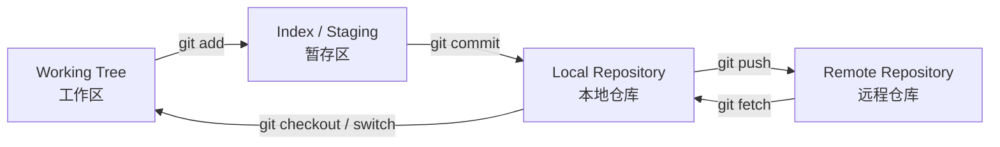

# Git

> Git 不是“保存文件”，而是“管理一组不可变提交组成的历史”。

## 本章目标

学完本章，你应该能够：

- 理解工作区、暂存区、本地仓库和远程仓库。
- 使用分支、合并和变基管理变更。
- 处理冲突、撤销和回滚。
- 用提交信息和小步提交保持历史可读。

## 核心模型



| 概念 | 含义 |
| --- | --- |
| Working Tree | 当前看到的文件 |
| Index / Staging | 下一次提交的内容 |
| Commit | 不可变快照 |
| Branch | 指向提交的引用 |
| HEAD | 当前所在位置 |
| Remote | 远程仓库 |

## 日常命令

```bash
git status
git diff
git add -p
git commit -m "feat: add order idempotency"
git log --oneline --graph --decorate
git push -u origin feature/order-idempotency
```

原则：

- 提交前看 `git diff`。
- 一次提交只做一件事。
- 提交信息说明“为什么”。
- 不提交密钥、构建产物、临时文件。

## 分支

```bash
git switch -c feature/order-idempotency
git switch main
git branch -d feature/order-idempotency
```

常见分支：

- `main`：稳定分支。
- `feature/*`：功能。
- `fix/*`：修复。
- `release/*`：发布。

## 合并与变基

### Merge

```bash
git switch main
git merge feature/order-idempotency
```

特点：

- 保留分支历史。
- 可能产生 merge commit。
- 适合公共分支。

### Rebase

```bash
git switch feature/order-idempotency
git rebase main
```

特点：

- 历史线性。
- 会改写提交。
- 不要 rebase 已经推送并被他人使用的公共分支。

## 冲突

```bash
git status
# 编辑冲突文件
git add <file>
git rebase --continue
# 或
git merge --continue
```

处理原则：

- 先理解两边改了什么。
- 不要盲目选 ours/theirs。
- 冲突解决后运行测试。

## 撤销

| 场景 | 命令 |
| --- | --- |
| 丢弃工作区修改 | `git restore <file>` |
| 取消暂存 | `git restore --staged <file>` |
| 修改最后一次提交 | `git commit --amend` |
| 回退提交但保留修改 | `git reset --soft HEAD~1` |
| 回退提交并丢弃修改 | `git reset --hard HEAD~1` |
| 安全撤销已推送提交 | `git revert <commit>` |

> `reset --hard` 会丢数据。执行前确认没有未保存内容。

## Stash

```bash
git stash push -m "wip: order refactor"
git stash list
git stash pop
```

适合临时切换分支。不要把 stash 当长期存储。

## Tag

```bash
git tag -a v1.2.0 -m "release 1.2.0"
git push origin v1.2.0
```

发布版本用 annotated tag。

## Hooks

常见：

- pre-commit：格式、lint。
- commit-msg：提交信息规范。
- pre-push：测试。

原则：

- 本地 hook 可以跳过，CI 必须兜底。
- hook 要快。
- 不要在 hook 里做危险操作。

## 常见错误

- 提交密钥。
- 提交构建产物。
- 大提交混合多个变更。
- rebase 公共分支。
- `reset --hard` 丢数据。
- 冲突不看就选一边。
- 不拉取就推送。
- 不会用 `revert`。
- 提交信息只有“update”。

## Git Review 清单

- [ ] 提交是否只做一件事？
- [ ] 提交信息是否说明原因？
- [ ] 是否检查了 diff？
- [ ] 是否包含密钥/构建产物？
- [ ] 是否 rebase 了公共分支？
- [ ] 冲突解决后是否运行测试？
- [ ] 回滚方式是否安全？
- [ ] 是否推送了 tag？

## 相关阅读

## 总结

Git 的核心，是把变更历史管理成可解释、可回滚的提交：

- 理解工作区、暂存区、本地仓库和远程仓库。
- 小步提交、提交信息说清“为什么”。
- 会用 revert/reset/stash，冲突解决后必须测试。

如果只能记住一件事：Git 保存的是“不可变提交历史”，不是“文件备份”。

- [GitHub](/tools/github)
- [工程实践](/software-engineering/engineering-practice)
- [CI/CD](/software-engineering/ci-cd)
