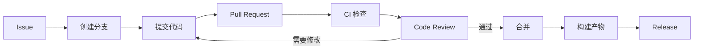
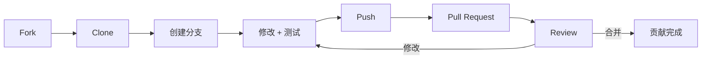

# GitHub

> GitHub 不只是代码托管，而是围绕代码的协作、自动化和安全平台。

## 本章目标

学完本章，你应该能够：

- 用 Issue、分支、PR 和 Review 组织协作。
- 配置分支保护和 GitHub Actions。
- 处理发布、安全扫描和依赖更新。
- 按开源项目规范提交贡献。

## 核心功能

| 功能 | 用途 |
| --- | --- |
| Repository | 代码和文档 |
| Issue | 需求、缺陷、讨论 |
| Pull Request | 代码审查和合并 |
| Actions | CI/CD 自动化 |
| Projects | 任务看板 |
| Releases | 版本发布 |
| Security | 依赖、密钥、代码扫描 |

## 从 Issue 到发布



## Pull Request

一个好的 PR：

- 只做一件事。
- 描述背景、方案、风险和测试。
- 变更小。
- CI 通过。
- 有明确 review 重点。

PR 描述模板：

```markdown
## 做了什么
...

## 为什么
...

## 重点 review
...

## 测试
- `./gradlew test`
- 新增 5 个边界测试
```

## 分支保护

建议：

- 保护 `main`。
- 禁止直接 push。
- 要求 PR。
- 要求 CI 通过。
- 要求至少一个 review。
- 要求分支最新。
- 限制强制推送。

## GitHub Actions

```yaml
name: ci

on:
  pull_request:
  push:
    branches: [main]

jobs:
  verify:
    runs-on: ubuntu-latest
    steps:
      - uses: actions/checkout@v4
      - uses: actions/setup-node@v4
        with:
          node-version: 20
      - run: npm ci
      - run: npm test
      - run: npm run build
```

原则：

- 缓存依赖。
- 失败快。
- 密钥用 Secrets。
- 最小权限 `permissions`。
- 第三方 Action 固定版本。

## Code Review

- 先看 PR 描述。
- 再看整体设计。
- 区分阻塞和非阻塞。
- 给出可执行建议。
- 不把个人偏好当阻塞。

## 安全

- 开启 Dependabot。
- 开启 secret scanning。
- 使用 CODEOWNERS。
- 限制 Actions 权限。
- 不在 PR 里贴密钥。
- 审查第三方依赖和 Action。

## GitHub CLI

```bash
gh repo view
gh pr create
gh pr checks
gh pr review
gh issue list
gh run list
```

适合自动化日常操作。

## 开源贡献



原则：

- 先读 CONTRIBUTING。
- 小步提交。
- 遵循项目风格。
- 写清测试。
- 尊重维护者时间。

## 常见错误

- PR 太大。
- 描述缺失。
- CI 不通过就请求 review。
- 直接 push main。
- 密钥进仓库。
- Action 权限过大。
- 不读贡献指南。
- 把 review 当吵架。

## GitHub Review 清单

- [ ] 仓库是否有 README 和贡献指南？
- [ ] 是否保护主分支？
- [ ] 是否要求 CI 和 review？
- [ ] Actions 权限是否最小？
- [ ] 是否开启依赖和密钥扫描？
- [ ] PR 是否小而清晰？
- [ ] 是否使用 CODEOWNERS？
- [ ] Release 是否可追溯？

## 相关阅读

## 总结

GitHub 的核心，是把代码协作变成可审查、可自动化、可追溯的流程：

- 用 Issue、PR、review 和分支保护组织变更。
- Actions 负责构建、测试和发布；密钥和权限最小化。
- 开源贡献从文档和小 bug 开始，遵守项目规范。

如果只能记住一件事：主分支必须受保护，CI 和 review 是合并前门槛。

- [Git](/tools/git)
- [Code Review](/software-engineering/code-review)
- [CI/CD](/software-engineering/ci-cd)
- [工程实践](/software-engineering/engineering-practice)
