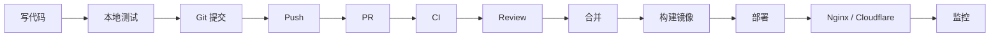

# 工具

> 工具的价值不是“会用命令”，而是让你更快、更安全、更可重复地完成工作。

工具链最容易出现的两个极端：一种是只会最基础的 `add/commit/push`，遇到回滚、冲突、远程排障就卡住；另一种是背了很多命令，却不清楚每条命令会改变什么，在生产环境上直接执行。工具的本质是可重复、可回滚、可解释的操作方式。

这个部分按日常开发流程组织：写代码 → 版本管理 → 运行环境 → 入口代理 → 边缘安全。

## 本章目标

学完本章，你应该能够：

- 理解日常开发、部署和运维工具链。
- 为不同任务选择合适的工具。
- 建立可重复、可回滚的操作习惯。
- 识别危险命令和权限边界。

## 工具链地图

| 阶段 | 工具 | 解决问题 |
| --- | --- | --- |
| 写代码 | VSCode、Cursor | 编辑、调试、AI 辅助 |
| AI 编程 | Codex、Claude Code、Copilot、Gemini CLI | 终端 Agent、补全、代码审查 |
| 版本管理 | Git、GitHub | 变更历史、协作、CI |
| 运行环境 | Linux、Docker | 部署、隔离、可重复环境 |
| 入口与代理 | Nginx | 反向代理、静态资源、TLS |
| 边缘与安全 | Cloudflare | DNS、CDN、WAF、Tunnel |

这些工具不是互相替代，而是组成一条请求链路：

## 学习原则

- 先学最小可用命令，再学高级技巧。
- 每个命令都要知道“会改什么”。
- 生产操作先备份、再执行。
- 用脚本和配置固化重复操作。
- 理解工具背后的模型，而不是背命令。

::: tip 工具学习以“事故”为导向
不用把每个工具都学全。优先学那些出事故时必须会的：Git 回滚、日志查看、端口/进程排查、容器日志、Nginx 配置检查。工具熟练度通常在故障中长出来。
:::

## 常见错误

Git 只会 `add/commit/push`，不会回滚；在生产直接 `rm -rf`；Docker 镜像巨大、无健康检查；Nginx 配置不测试就 reload；不区分环境配置；不备份；不读日志；权限过大。这些错误比“不会用高级命令”更常见。

## Tools Review 矩阵

| 维度 | 必须回答 | 不满足时怎么办 |
| --- | --- | --- |
| 版本 | 能否回滚、解释历史？ | 学 reset/revert/log |
| 协作 | PR、review、CI 是否规范？ | 用 GitHub 保护分支 |
| 环境 | 是否可重复、可隔离？ | 用容器、配置外置 |
| 入口 | 是否有 TLS、缓存、限流？ | 配 Nginx/Cloudflare 规则 |
| 安全 | 危险命令是否确认？ | 备份、dry-run、权限最小化 |
| 观测 | 出问题能否快速看日志？ | 熟悉 journalctl、docker logs |

## 总结

工具链的核心，是把重复操作变成可重复、可回滚的能力：

- Git 管变更历史，Docker 管环境，Nginx/Cloudflare 管入口。
- 先掌握故障时必须会的命令，再扩展高级用法。
- 所有生产操作都要可解释、可回滚。

如果只能记住一件事：工具熟练度不是命令数量，而是出事时能不能稳定恢复。

## 相关阅读

- [Git](/tools/git)
- [GitHub](/tools/github)
- [Linux](/tools/linux)
- [Docker](/tools/docker)
- [Nginx](/tools/nginx)
