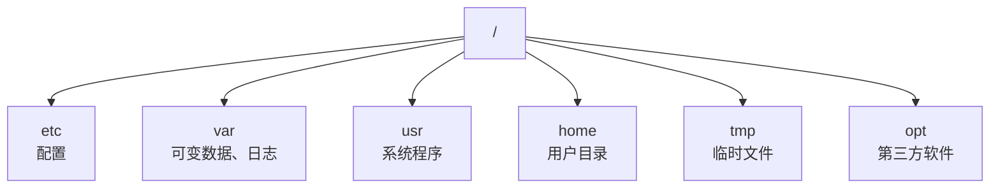
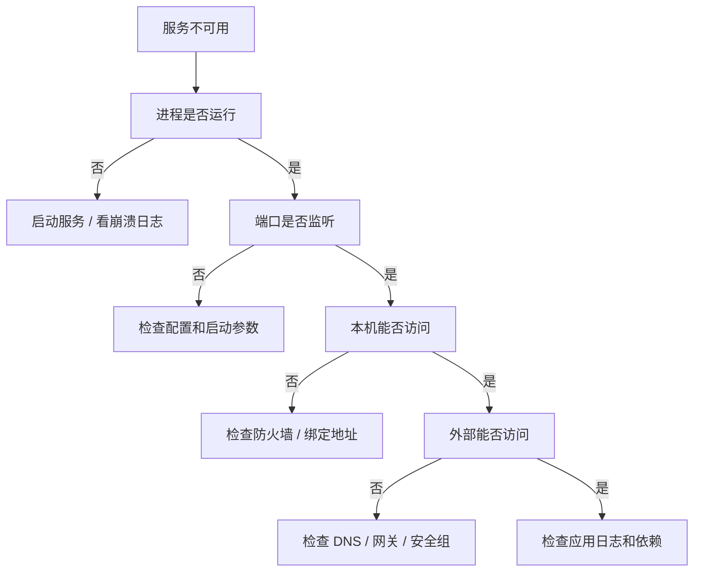

# Linux

> Linux 排障的核心是：先看现象，再看资源，再看日志，最后才改配置。

## 本章目标

学完本章，你应该能够：

- 理解文件系统、权限和进程。
- 使用 systemd 管理服务。
- 用网络、日志和磁盘工具排查故障。
- 写出安全、可重复的 shell 脚本。

## 文件系统



常用：

```bash
pwd
ls -lah
cd
find . -name "*.log"
du -sh *
df -h
```

## 权限

```bash
ls -l
chmod 750 app.sh
chown app:app app.sh
umask
```

权限位：

| 位 | 含义 |
| --- | --- |
| r | 读 |
| w | 写 |
| x | 执行/进入目录 |

原则：

- 最小权限。
- 不随意 `chmod 777`。
- 服务用专用用户。
- 敏感文件限制读权限。

## 进程

```bash
ps aux
top
htop
pgrep -af java
kill -TERM <pid>
kill -9 <pid>
```

信号：

- `TERM`：优雅终止。
- `KILL`：强制终止，最后手段。

## systemd

```bash
systemctl status app
systemctl start app
systemctl stop app
systemctl restart app
systemctl enable app
journalctl -u app -f
```

Unit 文件示例：

```ini
[Unit]
Description=Order Service
After=network.target

[Service]
User=app
ExecStart=/opt/app/bin/order-service
Restart=on-failure
RestartSec=5

[Install]
WantedBy=multi-user.target
```

## 网络

```bash
ip addr
ip route
ss -lntp
curl -v http://localhost:8080/health
dig example.com
traceroute example.com
```

排查顺序：



## 日志

```bash
journalctl -u app --since "10 min ago"
tail -f /var/log/app.log
grep -i error app.log
```

原则：

- 先看时间范围。
- 先看 ERROR/WARN。
- 关联 traceId。
- 注意日志轮转。

## 磁盘与内存

```bash
df -h
du -sh /var/log/*
free -h
vmstat 1
iostat -x 1
```

常见问题：

- 磁盘满。
- inode 用完。
- 内存溢出。
- swap 频繁。
- IO 等待高。

## Shell

```bash
set -euo pipefail
command1 && command2
command1 || command2
cmd > out.log 2>&1
```

脚本原则：

- 失败要退出。
- 变量加引号。
- 不在生产执行未审查脚本。
- 危险操作先 dry-run。

## 常见错误

- `rm -rf` 路径写错。
- `chmod 777`。
- `kill -9` 当默认。
- 不看日志就重启。
- 不检查磁盘和内存。
- 生产直接改配置不备份。
- 用 root 跑服务。
- 防火墙/安全组漏配。

## Linux Review 清单

- [ ] 服务是否用专用用户运行？
- [ ] 权限是否最小？
- [ ] 是否有 systemd 管理和自动重启？
- [ ] 日志是否可查？
- [ ] 磁盘和 inode 是否监控？
- [ ] 端口和防火墙是否正确？
- [ ] 是否有备份和回滚？
- [ ] 脚本是否 `set -euo pipefail`？
- [ ] 危险命令是否确认？
- [ ] 是否有监控和告警？

## 相关阅读

## 总结

Linux 的核心，是用进程、日志和资源指标定位问题：

- 文件权限最小化，服务用专用用户和 systemd 管理。
- 排障顺序：进程 → 端口 → 网络 → 日志 → 磁盘/内存。
- 脚本要失败即退，生产操作先备份再执行。

如果只能记住一件事：先看现象和日志，再改配置。

- [Docker](/tools/docker)
- [Nginx](/tools/nginx)
- [可观测性](/software-engineering/observability)
