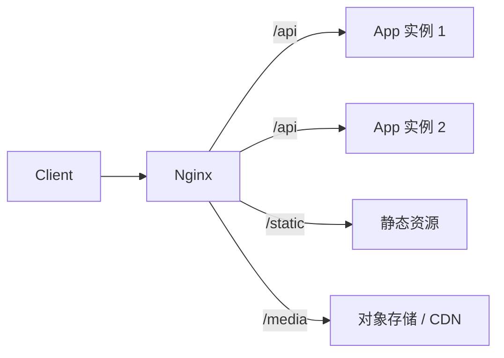

# Nginx

> Nginx 通常站在流量入口：做 TLS、路由、静态资源、缓存、限流和反向代理。

## 本章目标

学完本章，你应该能够：

- 配置反向代理和静态资源。
- 设置 TLS、负载均衡和缓存。
- 用限流和超时保护上游。
- 用配置检查和日志排查 502/504。

## 常见角色



## 配置结构

```nginx
events {}

http {
    server {
        listen 80;
        server_name example.com;

        location / {
            proxy_pass http://app_backend;
        }
    }

    upstream app_backend {
        server 10.0.0.1:8080;
        server 10.0.0.2:8080;
    }
}
```

## 反向代理

```nginx
location /api/ {
    proxy_pass http://app_backend/;
    proxy_set_header Host $host;
    proxy_set_header X-Real-IP $remote_addr;
    proxy_set_header X-Forwarded-For $proxy_add_x_forwarded_for;
    proxy_set_header X-Forwarded-Proto $scheme;
    proxy_connect_timeout 3s;
    proxy_read_timeout 30s;
}
```

注意：

- `proxy_pass` 末尾斜杠影响路径。
- 传递真实 IP 和协议。
- 设置超时。
- 上游健康检查。

## 静态资源

```nginx
location /static/ {
    root /var/www;
    expires 30d;
    add_header Cache-Control "public, immutable";
}
```

原则：

- 静态资源走 CDN。
- 带 hash 的文件长缓存。
- HTML 短缓存或不缓存。

## TLS

```nginx
server {
    listen 443 ssl http2;
    server_name example.com;

    ssl_certificate /etc/letsencrypt/live/example.com/fullchain.pem;
    ssl_certificate_key /etc/letsencrypt/live/example.com/privkey.pem;

    ssl_protocols TLSv1.2 TLSv1.3;
}
```

原则：

- 强制 HTTPS。
- 使用自动续期。
- 不在配置里写死私钥内容。

## 负载均衡

```nginx
upstream app_backend {
    least_conn;
    server 10.0.0.1:8080 weight=3;
    server 10.0.0.2:8080;
    keepalive 32;
}
```

策略：

- round-robin。
- least_conn。
- ip_hash。
- weighted。

## 缓存

```nginx
proxy_cache_path /var/cache/nginx levels=1:2 keys_zone=api_cache:10m max_size=1g inactive=60m;

location /api/public/ {
    proxy_cache api_cache;
    proxy_cache_valid 200 60s;
    add_header X-Cache-Status $upstream_cache_status;
}
```

注意：

- 只缓存可缓存的响应。
- 登录/个性化接口不要缓存。
- 缓存 key 要包含必要维度。

## 压缩

```nginx
gzip on;
gzip_types text/plain text/css application/json application/javascript;
gzip_min_length 1024;
```

不要压缩图片和视频。

## 限流

```nginx
limit_req_zone $binary_remote_addr zone=api:10m rate=10r/s;

location /api/ {
    limit_req zone=api burst=20 nodelay;
}
```

## 日志

```nginx
log_format main '$remote_addr - $request '
                '$status $body_bytes_sent '
                '$request_time $upstream_response_time';
```

关注：

- 5xx。
- 499（客户端断开）。
- upstream 超时。
- 请求时间。

## 配置检查

```bash
nginx -t
nginx -s reload
```

永远先 `nginx -t`，再 reload。

## 常见错误

- 不测试配置就 reload。
- `proxy_pass` 路径错误。
- 不传真实 IP。
- 超时不合理。
- 缓存登录接口。
- 静态资源不缓存。
- TLS 配置过期。
- 不限流。
- 日志没有 upstream 时间。

## Nginx Review 清单

- [ ] 配置是否 `nginx -t` 通过？
- [ ] 是否强制 HTTPS？
- [ ] 是否传递真实 IP 和协议？
- [ ] 超时是否合理？
- [ ] 静态资源是否缓存？
- [ ] 动态接口是否避免误缓存？
- [ ] 是否配置限流？
- [ ] 是否有健康检查？
- [ ] 日志是否包含关键字段？
- [ ] 证书是否自动续期？

## 相关阅读

## 总结

Nginx 的核心，是站在流量入口做路由、TLS、缓存和限流：

- 反向代理要传真实 IP、设超时，上游要健康检查。
- 静态资源长缓存，动态接口避免误缓存。
- 配置先 `nginx -t` 再 reload，日志看 5xx 和 upstream 时间。

如果只能记住一件事：Nginx 的错误大多在 `proxy_pass` 路径、超时和缓存配置上。

- [Linux](/tools/linux)
- [Docker](/tools/docker)
- [Cloudflare](/tools/cloudflare)
- [可观测性](/software-engineering/observability)
